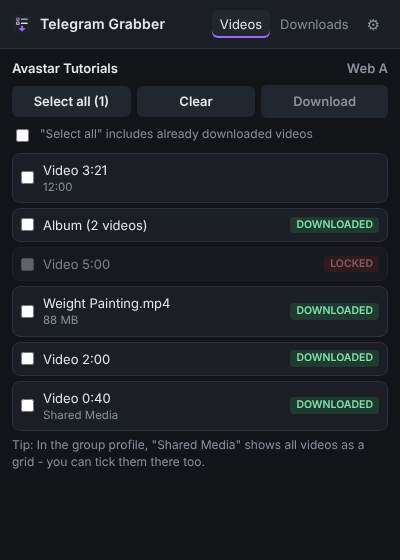
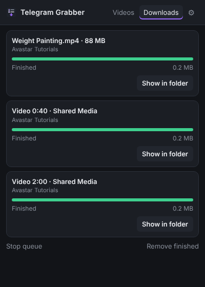

<h1 align="center">Telegram Grabber</h1>

Select many videos in <b>Telegram Web</b> and download them in one go. 
A small browser extension for Brave and Chrome - with only the permissions it really needs.

---

## Why

Telegram groups are full of great tutorials, but the videos are often too large to stream on the go.
Telegram Web only lets you download them one by one, and the existing downloader extensions ask for
access to *every* website you visit. Telegram Grabber does one thing: tick the videos you want, press
**Download**, done.

## Features

- **Checkboxes on every video** in the chat and in the **Shared Media** grid of a group
- **Select all** visible videos with one click
- **Download queue** - videos are downloaded one after another, 1-5 at the same time
- **Progress per video** in the extension popup, with *Show in folder* and *Retry*
- **Remembers what you already downloaded** - those videos are marked and skipped by *Select all*
- **Own subfolder** inside your download folder (default: `Telegram`)
- Works with **both** Telegram Web versions: `web.telegram.org/k/` and `web.telegram.org/a/`
- Respects groups where the admin has **disabled saving** - those videos are locked
- Dark UI, no tracking, no external servers

| Videos | Downloads |
|---|---|
|  |  |

## Permissions

| Permission | Why |
|---|---|
| `https://web.telegram.org/*` (content script) | Show the checkboxes and trigger Telegram's own *Download* action. **No access to any other website.** |
| `downloads` | Put the files into your subfolder and show the progress |
| `storage` | Remember your settings and which videos were already downloaded |

The extension does not collect data, does not talk to any server and does not log in to Telegram by itself.
It simply clicks Telegram's own *Download* entry for you, so the download works exactly as if you had done it by hand.

## Installation

The extension is not in the Chrome Web Store (yet), so it is installed as an "unpacked extension":

1. Download the latest ZIP from [Releases](../../releases) - or use the green **Code** button → **Download ZIP** - and unpack it.
2. **Windows:** double-click `install.bat`. It copies the extension to `%LOCALAPPDATA%\Telegram-Grabber`,
   puts that path into your clipboard and opens the Brave extensions page.
   **Other systems:** use the `extension` folder directly.
3. Turn on **Developer mode** (top right on the extensions page).
4. Click **Load unpacked**, paste the path (Ctrl+V) and select the folder.
5. Pin the extension via the puzzle icon, then reload your Telegram Web tab (F5).

**Update:** run `install.bat` again and click the reload arrow on the extension card.

## Usage

1. Open a group in Telegram Web.
2. Tick the checkbox on the videos you want - in the chat or in the group profile under **Shared Media**
   (the grid shows many more videos at once). Or open the extension popup and use **Select all**.
3. Press **Download** in the popup. Progress is shown in the **Downloads** tab.
4. Keep the Telegram tab open until everything is finished. The popup itself may be closed.

Checkbox colors: purple = selected, orange = in queue, green = already downloaded, lock = saving disabled.

### Tips

- **The browser asks where to save every file?** Turn off *"Ask where to save each file before downloading"*
  in the browser settings under *Downloads*. Then all videos go straight into the subfolder.
- **Slow downloads** are a Telegram limit for accounts without Premium. The limit applies per file, so
  3-4 parallel downloads (gear icon) finish a long list faster.
- Older videos appear as soon as you scroll to them in the chat or in Shared Media.

## Limitations

- Telegram Grabber works with Telegram's web interface. When Telegram changes it, the extension may need an
  update - please open an [issue](../../issues) if the checkboxes disappear.
- Videos downloaded before installing the extension are not recognized as "already downloaded".
- Only meant for content you are allowed to save. Content protected by the group admin is not downloaded.

## Disclaimer

This project is not affiliated with, endorsed by or connected to Telegram.
"Telegram" is a trademark of its respective owner.

## License

[MIT](LICENSE) © 2026 Mono T. - made with love.
